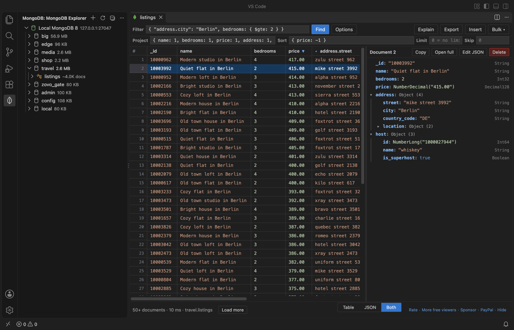

# MongoDB Client & MongoDB GUI for VS Code

A free MongoDB client and MongoDB GUI inside VS Code. Browse databases and collections, query with a filter bar, edit documents in a grid (nested fields too) or as JSON, build aggregations with a stage preview, read explain plans, manage indexes, and import or export with streams.

Free, no sign-in, no telemetry. Network: the extension talks only to the MongoDB servers you add, and only when you open one. It does not connect on startup, sends no keep-alive queries, and closes an idle connection after 10 minutes.

Works with MongoDB 4.2 and later (tested on 8.3), MongoDB Atlas (`mongodb+srv://`), replica sets, Azure Cosmos DB for MongoDB, Azure DocumentDB, Amazon DocumentDB and FerretDB. Also in Cursor, Windsurf and VSCodium (VS Code 1.90 or later).

Not affiliated with MongoDB, Inc. MongoDB is a trademark of MongoDB, Inc.

## Why this one

Measured against what people say about the other MongoDB tools in VS Code (reviews since 2025):

| What users complained about | What this extension does |
|---|---|
| "The only negative is the Telemetry. I hate extensions that automatically enable telemetry" ([MongoDB for VS Code review, March 2026](https://marketplace.visualstudio.com/items?itemName=mongodb.mongodb-vscode&ssr=false#review-details)) | No telemetry at all. There is no setting to find, because nothing is collected. |
| An extension that "will automatically run 'SELECT 1' statements to ensure that it remains connected" raised a serverless bill ([DBCode review, February 2026](https://marketplace.visualstudio.com/items?itemName=DBCode.dbcode&ssr=false#review-details)) | No keep-alive queries. The connection closes after 10 idle minutes (setting) and opens again on your next click. |
| "Editing and saving in the table also requires the pro version" and "now you can not even edit a table without paying" ([DBCode reviews, 2025](https://marketplace.visualstudio.com/items?itemName=DBCode.dbcode&ssr=false#review-details)) | Editing is free, always: grid cells, nested fields, whole documents, inserts, deletes, imports and exports. |
| No table grid with inline edit in the MongoDB playground view | A grid where every top-level field is a column, nested documents and arrays open into sub-columns, and a double-click edits a value. |

Numbers from the release gate in VS Code 1.142 with MongoDB 8.3 on an Apple M-series Mac: activation in 9 ms, with no connection and no open socket for 2 minutes after startup; a 1,000,000-document collection opens in pages of 50 with "Load more" (the cursor stays open, nothing loads the whole result); five 10.8 MB documents open without a freeze (long values are shortened in the grid, "Open full" shows everything); a 1,000,000-document export to JSONL streams in under 10 s with the memory flat; an idle connection closes and leaves no socket open.

## Features (all free)

### Connections
- Connection string (`mongodb://` and `mongodb+srv://`), user and password, auth database, TLS with a CA file, replica sets, direct connection, read preference.
- Passwords live in VS Code secret storage. A password inside a pasted string is moved there when you save.
- 10 second server selection timeout and plain messages: wrong password, nothing listening, DNS, TLS.
- A read-only switch per connection blocks every change: edits, inserts, deletes, imports, drops, index changes, `$out` and `$merge`.

### Explorer
- Databases, collections, views and indexes, loaded when you expand them.
- Document counts are estimated from collection metadata (no collection scan).

### Documents
- Grid: top-level fields are columns; click ▸ in a cell to open a nested document or array into columns.
- JSON view of the selected document, side by side with the grid (Table, JSON or Both).
- Double-click a cell to edit it, with a type picker. Types are kept on write: Int64 stays Int64, Decimal128 keeps its digits, ObjectId, ISODate and Binary stay what they are.
- Edit a whole document as JSON, insert one or many documents, delete with a confirmation.
- Updates use `{ _id: <the _id exactly as stored> }`. Int64 and Decimal128 values never pass through a JavaScript number, so `NumberLong("9007199254740993")` is never confused with its neighbour.

### Query bar
- Filter, projection, sort, limit and skip in shell syntax: `{ year: { $gte: 2000 }, "address.city": "Berlin" }`, `ObjectId("…")`, `ISODate("…")`, `/regex/i`.
- Field names complete as you type, from a 100-document sample.
- "Load more" reads the next page from the open cursor. Click a column header to sort on the server.
- Explain shows the plan as a tree with plain hints: collection scan, in-memory sort, documents examined per result, the index used.
- Update or delete every matching document, after a count and a confirmation. An empty filter (`deleteMany({})`) gets a stronger warning.

### Aggregation
- Pipeline editor with a preview of the first 20 documents after every stage.
- Run opens the whole result in a grid; Explain shows the plan; Cancel stops the running stage on the server (`killOp`). `$out` and `$merge` never run in the preview and ask before a real run.
- Queries and aggregations have a server-side time limit (`maxTimeMS`, 60 s by default, setting `zovoMongo.queryTimeoutSeconds`).

### Indexes
- List with keys and options; create single, compound, unique, sparse and TTL indexes; drop with a confirmation.

### Import and export
- Export a collection or the current query to JSON, JSONL or CSV, streamed with a progress bar and a Cancel button. JSON keeps Int64 values above 2^53 and Decimal128 exact.
- Import JSON (an array or one document after another), JSONL and CSV in batches of 1,000 with a progress bar. A broken file stops at its line number and says how many documents went in before it.

## Zovo Pro (optional)

Two professional tools, each with 3 free tries:

- Schema Analysis: samples 1,000 documents and shows every field with its types, how often it appears, ranges and common values; fields with more than one type are marked. Writes a `$jsonSchema` validator draft from it.
- Compare Two Collections: compares two collections on any two connections in `_id` order, lists the documents that are only on one side or different (field by field), and writes a mongosh script that makes the second match the first. The script is never run for you.

Zovo Pro is USD 19 once and unlocks Pro in every Zovo extension: GitHub Sponsors, PayPal, or a license key. Everything in "Features" above stays free. No popups when you open anything; the only prompt comes when you start a Pro tool after its free tries. Hide both tools with the setting `zovoMongo.showProFeatures`.

## Getting started

1. Open the MongoDB view in the activity bar and click Add Connection.
2. Paste a connection string, type the password, Test connection, Save.
3. Expand the connection and click a collection.

Keyboard: Enter runs the query, Enter saves a cell, Shift+Enter adds a line, Esc cancels, Delete removes the selected documents (after a confirmation), Ctrl/Cmd+C copies them as JSON.

## Settings

| Setting | Default | What it does |
|---|---|---|
| `zovoMongo.pageSize` | 50 | Documents per page in the grid |
| `zovoMongo.connectTimeoutSeconds` | 10 | Server selection and connect timeout |
| `zovoMongo.idleCloseMinutes` | 10 | Close an idle connection after this many minutes |
| `zovoMongo.queryTimeoutSeconds` | 60 | `maxTimeMS` for queries, previews and aggregations (0 = none) |
| `zovoMongo.showSupportLinks` | true | The small Rate / More / Sponsor links under the grid |
| `zovoMongo.askForRating` | true | One quiet rating question after real use, at most twice |
| `zovoMongo.showProFeatures` | true | Show the two Zovo Pro tools in the menus |

## Privacy and network

- Connects only to the servers you add, only when you open one. Closes them after the idle time and when VS Code closes.
- While a connection is open, the MongoDB driver checks the server once a minute (server monitoring). Nothing runs while it is closed.
- No telemetry, no analytics, no update checks, no account. Passwords stay in VS Code secret storage.
- The optional GitHub Sponsors unlock asks GitHub one question, only when you click it.

## Known limits

- No mongosh shell or JavaScript playground: queries run through the query bar and the pipeline editor.
- Values longer than 2,000 characters, binaries over 2 KB and arrays over 200 items are shortened in the grid; "Open full" shows the whole document. A shortened field cannot be edited inline.
- Field names that contain a dot can be edited at the top level (MongoDB 5.0 or later) or through Edit JSON.
- Kerberos (GSSAPI), AWS IAM and client-side field level encryption are not included (they need native modules).

## Support Zovo

Zovo extensions are free, with no ads and no tracking. They are made by [theluckystrike](https://github.com/theluckystrike) on GitHub. If this one saves you time, you can support the work:

- [Sponsor on GitHub](https://github.com/sponsors/theluckystrike)
- [PayPal](https://www.paypal.com/paypalme/najzzz)
- [Follow theluckystrike on GitHub](https://github.com/theluckystrike)

### Need your format supported?

Open a [format request](https://github.com/theluckystrike/mongodb-client-vscode/issues/new?template=format-request.yml) with a sample file, and I reply there whether it can be done. For USD 299 once, through [this GitHub Sponsors tier](https://github.com/sponsors/theluckystrike/sponsorships?tier_id=679995), I add your file format or a missing feature to this extension, with tests, within 7 days.

## More tools by Zovo

- [Postgres & MySQL Query Client - SQL Database Tool (SQLite, CSV Export)](https://marketplace.visualstudio.com/items?itemName=zovo.zovo-sql-client) Free PostgreSQL client and MySQL client for VS Code: unlimited connections, edit rows, streamed CSV export. Run SQL with Ctrl+Enter, browse tables, cancel long queries. Also MariaDB and SQLite. No sign-in, no telemetry, no keep-alive queries.
- [Large JSON Viewer, JSON Browser & JSON Tree](https://marketplace.visualstudio.com/items?itemName=zovo.zovo-json-tree-viewer) shows large JSON files as a searchable tree, copies JSONPath and turns arrays of objects into a table.
- [JSONL Viewer, Large JSONL Table & NDJSON Viewer](https://marketplace.visualstudio.com/items?itemName=zovo.zovo-jsonl-viewer) opens JSONL and NDJSON files as a table, as records or as a chat view.
- [SQLite Viewer & SQLite3 DB File Browser, Database Explorer](https://marketplace.visualstudio.com/items?itemName=zovo.sqlite-table-viewer) browses SQLite tables read-only and runs SELECT queries.
- [GeoJSON Viewer, KML Viewer & GPX Viewer (Map Preview, Shapefile)](https://marketplace.visualstudio.com/items?itemName=zovo.zovo-geo-map-viewer) GeoJSON viewer, KML viewer and GPX viewer with a map preview in VS Code. Also opens shapefiles (SHP, zipped), KMZ, TopoJSON, WKT and CSV with lat/lon: feature table, properties, GPX distance and elevation profile, reprojection from .prj, PNG export. Free, no sign-in, works offline.

See [all Zovo extensions on the Marketplace](https://marketplace.visualstudio.com/publishers/zovo).

## License

MIT. The bundled MongoDB Node.js driver and BSON library are Apache-2.0; see THIRD-PARTY-NOTICES.md.

## More from zovo

- [All free zovo VS Code extensions](https://marketplace.visualstudio.com/publishers/zovo) — file viewers, database clients, formatters. Offline, no telemetry, no sign-up.
- [Full MCP server catalogue](https://theluckystrike.github.io/mcp/) — local-first MCP servers for back-office work: invoices, VAT, PDFs, spreadsheets, payroll.
- [Hosted no-install MCP endpoints](https://mcp.zovo.one) — paste a URL in Claude / Cursor, nothing to install.
